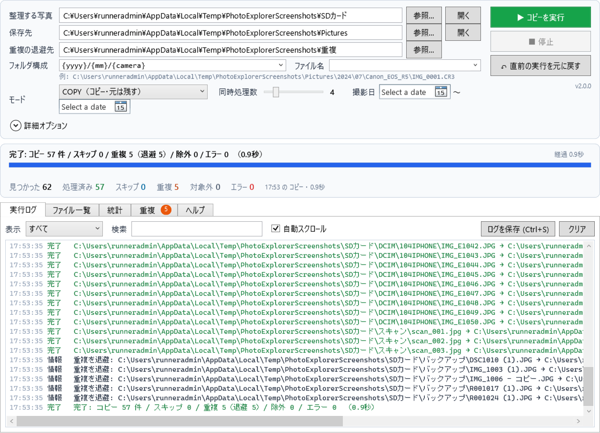
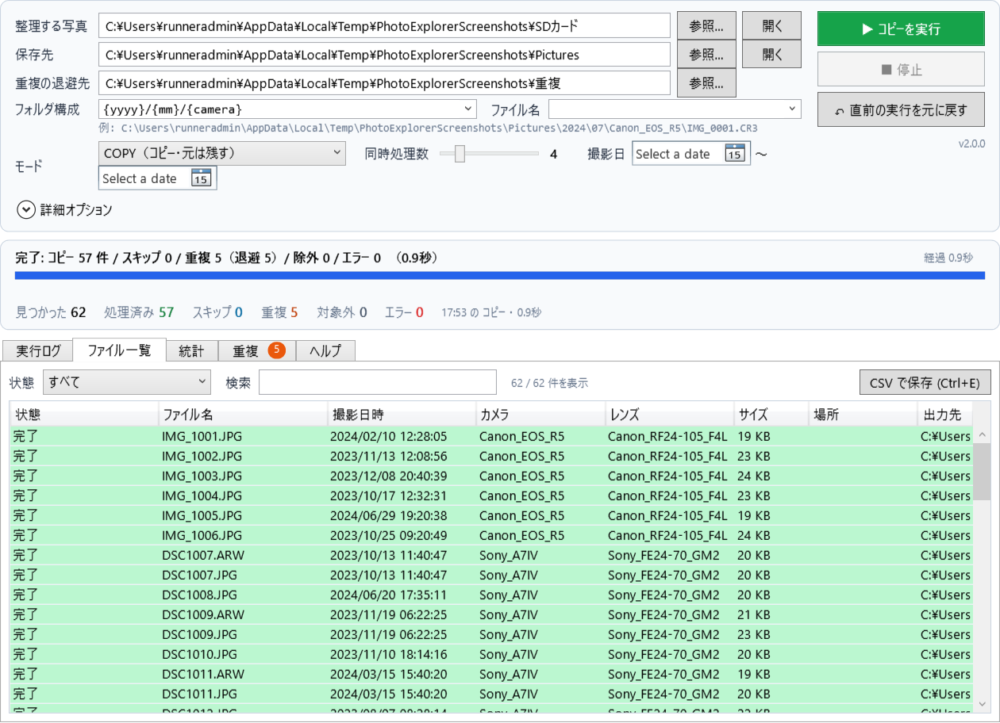
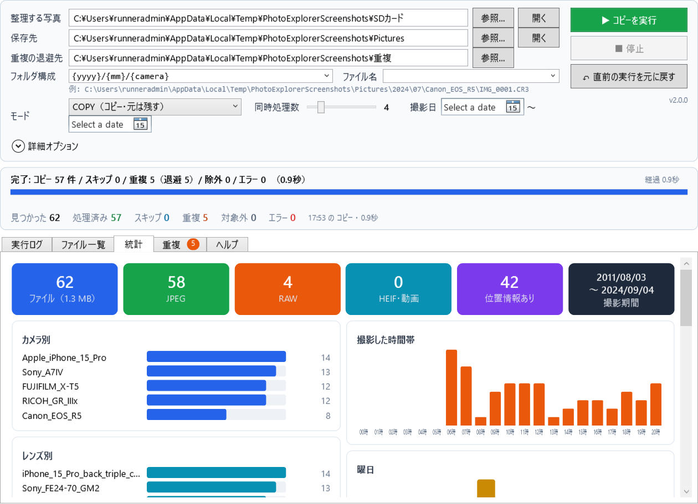
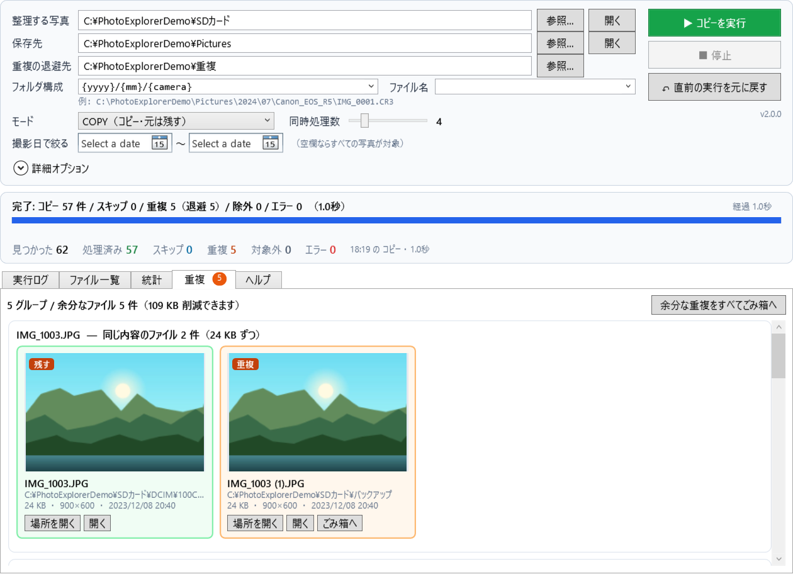
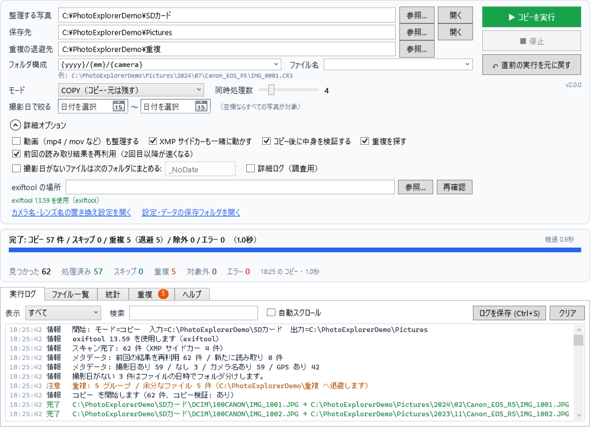

# PhotoExplorer

**日本語** | [English](README.en.md)

カメラや SD カードから取り込んだまま散らかっている写真を、**撮影日・カメラ・撮影地などの情報（EXIF）をもとに、きれいなフォルダ構成へ自動で整理する** Windows 用のアプリです。



たとえば「整理する写真」に SD カードの中身を、「保存先」に `D:\Pictures` を指定して実行すると、次のように並べ替えます。

```
D:\Pictures
├── 2024
│   ├── 07
│   │   ├── Canon_EOS_R5
│   │   │   ├── IMG_1001.JPG
│   │   │   └── IMG_1002.JPG
│   │   └── Sony_A7IV
│   │       ├── DSC1010.ARW
│   │       ├── DSC1010.xmp   ← Lightroom のサイドカーも一緒に
│   │       └── DSC1010.JPG
│   └── 08
│       └── ...
└── 2023
    └── ...
```

フォルダの分け方は `{yyyy}/{mm}/{dd}/{camera}` のような「テンプレート」で自由に決められます。撮影地（都市名）やレンズ、RAW と JPEG の種類で分けることもできます。

---

## できること

- **写真を探す** — フォルダの中をサブフォルダまで探して、JPEG・HEIC・各社 RAW（CR3 / NEF / ARW / RAF / ORF / RW2 / DNG など）を見つけます。動画（mp4 / mov）も対象にできます。
- **撮影情報で整理する** — 撮影日時・カメラ・レンズ・GPS の位置・レーティング（★）を読み取り、テンプレートどおりのフォルダへコピーまたは移動します。ファイル名の付け替えもできます。
- **まずは試せる** — `DRY_RUN` モードではファイルに一切触れず、「どのファイルがどこに行くか」だけを確認できます。
- **重複を見つける** — 中身がまったく同じファイルをハッシュで見つけ、サムネイル付きで一覧表示します。余分な方は退避フォルダへ移すか、Windows のごみ箱へ送れます。
- **あとから元に戻せる** — コピー・移動したファイルはすべて記録されます。途中で止めた実行や数日前の実行でも、ボタン一つで元の状態に戻せます。
- **統計を見る** — カメラ別・レンズ別・月別・撮影地・時間帯・曜日などをグラフで表示します。これまでの実行履歴も残ります。
- **何度実行しても安全** — 保存先に同じ写真が既にあればスキップするので、SD カードを毎回まるごと指定しても写真が増えていきません。

---

## はじめかた

### 1. ダウンロード

**[Releases（最新版）](https://github.com/sui-sfc/PhotoExplorer/releases/latest)** を開き、「Assets」にある **`PhotoExplorer-win-x64.zip`** をダウンロードして、好きな場所に展開します。

- .NET のインストールは不要です。
- 初回起動時に「Windows によって PC が保護されました」と表示されたら、「詳細情報」→「実行」を押してください。

自分でビルドする場合は [開発者向け](#開発者向け) を参照してください。

### 2. exiftool を用意する

写真の撮影情報を読むのに、無料のツール [ExifTool](https://exiftool.org/)（作者: Phil Harvey）を使います。PhotoExplorer には同梱していないので、各自で入手してください。

1. exiftool.org のトップページから **Windows Executable**（64-bit の zip）をダウンロードします。
2. 展開すると `exiftool(-k).exe` と `exiftool_files` フォルダがあります。この **2 つとも** を、`PhotoExplorer.exe` と同じ場所にある `Resources` フォルダへ入れます。

```
PhotoExplorer.exe
Resources\
├── exiftoolの置き場所.txt
├── exiftool(-k).exe     ← exiftool.exe に名前を変えても OK
└── exiftool_files\
```

exiftool が見つからないと、アプリの上部に案内が表示されます。そこにある「exiftool.org を開く」「Resources フォルダを開く」ボタンを使うと簡単です。入れたら「再確認」を押してください。「詳細オプション」に「exiftool 13.xx を使用」と緑色で表示されれば OK です。

すでに PATH の通った場所に exiftool がある場合はそのまま使われます。別の場所に置きたい場合は、「詳細オプション」で場所を指定できます。

> 都市名でのフォルダ分け（`{city}` など）には exiftool **12.78 以降** が必要です。

### 3. 起動して整理する

1. **整理する写真** に、写真が入っているフォルダを指定します（エクスプローラーからドラッグ＆ドロップでも指定できます）。
2. **保存先** に、整理した写真を置くフォルダを指定します。
3. **フォルダ構成** を一覧から選ぶか、自分で入力します。すぐ下に「例: D:\Pictures\2024\07\15\Canon_EOS_R5\IMG_0001.CR3」のような完成イメージが出ます。
4. モードを **DRY_RUN** にして「▶ 実行」（または F5）。ファイルは変更されません。
5. 「ファイル一覧」タブで行き先を確認し、問題なければモードを **COPY**（元を残す）か **MOVE**（移動する）にしてもう一度実行します。



うまくいかなかったときは「↶ 直前の実行を元に戻す」を押せば、コピーしたファイルは削除され、移動したファイルは元の場所に戻ります。

---

## 画面の紹介

### 統計

撮影したカメラやレンズの割合、よく撮る時間帯や曜日、撮影地などをグラフで確認できます。下の「実行履歴」からは、過去の実行を個別に取り消せます。



### 重複

中身がまったく同じファイルを、サムネイル付きでグループごとに表示します。緑の枠が残すファイル、オレンジの枠が余分なファイルです。「(1)」「- コピー」のような名前のほうを余分と判断します。



### 詳細オプション



| オプション | 説明 |
|---|---|
| 動画も整理する | mp4 / mov / mts なども対象にします |
| XMP サイドカーも一緒に動かす | `IMG_0001.xmp` や `IMG_0001.CR3.xmp` を写真と同じ場所へ。ファイル名を変えたときはサイドカーの名前も合わせます |
| コピー後に中身を検証する | 書き込んだファイルを読み直し、元と同じかハッシュで確認します |
| 重複を探す | オフにすると少し速くなります |
| 前回の読み取り結果を再利用 | 変更のないファイルは exiftool を呼ばずに済むので、2 回目以降がかなり速くなります |
| 撮影日がないファイルをまとめる | スキャンした写真など撮影日がないものを `_NoDate` などのフォルダに集めます。オフの場合はファイルの日時を使います |
| 詳細ログ | 1 枚ごとの読み取り結果をすべてログに出します（うまく分類されないときの調査用） |

---

## フォルダ構成のテンプレート

`/` で区切ったそれぞれがフォルダになります。ファイル名のテンプレートにも同じ変数が使えます（拡張子は自動で付きます）。アプリの「ヘルプ」タブで変数をクリックすると、テンプレートに追加されます。

| 変数 | 内容 | 例 |
|---|---|---|
| `{yyyy}` / `{yy}` | 撮影年（4 桁 / 2 桁） | 2024 / 24 |
| `{mm}` / `{MMM}` | 撮影月（2 桁 / 英語の略称） | 07 / Jul |
| `{dd}` | 撮影日 | 15 |
| `{HH}` `{min}` `{ss}` | 撮影時・分・秒 | 09 05 42 |
| `{camera}` | カメラ名 | Canon_EOS_R5 |
| `{make}` | メーカー名 | Canon |
| `{lens}` | レンズ名 | Canon_RF24-105_F4L |
| `{type}` | 種類（JPEG / RAW / HEIF / VIDEO） | RAW |
| `{ext}` | 拡張子 | cr3 |
| `{rating}` | レーティング（★ の数、なければ 0） | 4 |
| `{city}` `{region}` `{country}` `{countrycode}` | 撮影地（GPS 付きの写真のみ） | Shibuya / Tokyo / Japan / JP |
| `{name}` | 元のファイル名（拡張子なし） | IMG_0001 |

よく使う組み合わせの例:

| テンプレート | 結果 |
|---|---|
| `{yyyy}/{mm}/{dd}/{camera}` | 2024\07\15\Canon_EOS_R5\IMG_0001.CR3 |
| `{yyyy}/{yyyy}-{mm}-{dd}` | 2024\2024-07-15\IMG_0001.CR3 |
| `{yyyy}/{mm}/{type}` | 2024\07\RAW\IMG_0001.CR3 |
| `{country}/{city}/{yyyy}-{mm}` | Japan\Shibuya\2024-07\IMG_0001.CR3 |
| ファイル名 `{yyyy}{mm}{dd}_{HH}{min}{ss}` | …\20240715_090542.CR3 |

### カメラ名・レンズ名を好きな名前にする

「詳細オプション」→「カメラ名・レンズ名の置き換え設定を開く」で `mappings.json` がメモ帳で開きます。左に元の名前（一部だけでも可）、右にフォルダ名にしたい名前を書いて保存すると、次の実行から反映されます。

```json
{
  "Camera": {
    "RICOH GR IIIx": "GR3x",
    "ILCE-7M4": "α7IV"
  },
  "Lens": {
    "FE 24-70mm F2.8 GM II": "2470GM2"
  }
}
```

---

## 安全のための仕組み

- **上書きしません。** 同じ名前で中身が違うファイルがあれば `IMG_0001_001.JPG` のように連番を付けます。
- **同じ写真は二重に保存しません。** 保存先に中身が同じファイルがあればスキップします。
- **コピーを検証します。** 書き込んだファイルを読み直して、元と完全に一致するかを確認します。
- **ドライブをまたぐ移動は慎重に。** 別のドライブへの MOVE は「コピー → 検証 → 元を削除」の順に行います。
- **すべて記録します。** 操作は 1 件ずつ記録されるので、途中で止めたり PC が落ちたりしても、そこまでの分を元に戻せます。
- **実行前にチェックします。** 入力と保存先が同じ、テンプレートの書き間違い、保存先に書き込めない、などは実行前に知らせます。MOVE の前には確認ダイアログが出ます。

---

## よくある質問

**カメラ名が `Unknown` になる / 撮影日がおかしい**
exiftool が見つかっていない可能性があります。「詳細オプション」に表示される exiftool の状態を確認してください。それでも直らない場合は「詳細ログ」をオンにして実行すると、1 枚ごとに読み取れた Make / Model / 日時がログに出ます。

**都市名が `Unknown` になる**
GPS 情報がない写真か、exiftool が 12.78 より古い可能性があります。

**HEIC や RAW のサムネイルが「プレビューなし」になる**
Microsoft Store の「HEIF 画像拡張機能」「Raw 画像拡張機能」を入れると表示されるようになります（整理自体には影響しません）。

**2 回目以降の実行が速いのはなぜ？**
前回読み取った撮影情報を覚えていて、ファイルが変わっていなければ再利用するからです。

**設定や履歴はどこに保存される？**
`%LocalAppData%\PhotoExplorer` です（「ヘルプ」タブから開けます）。`PhotoExplorer.exe` と同じ場所に `portable.txt` という空のファイルを置くと、隣の `Data` フォルダに保存する「ポータブルモード」になり、USB メモリに入れて持ち歩けます。

**Mac や Linux で使える？**
画面部分は Windows 専用（WPF）です。整理の処理本体（`PhotoExplorer.Core`）は Windows 以外でも動くように作ってあり、テストは Linux でも実行しています。

### キーボードショートカット

| キー | 動作 |
|---|---|
| F5 | 実行 |
| Esc | 停止 |
| Ctrl + S | ログを保存 |
| Ctrl + E | ファイル一覧を CSV で保存 |

---

## 開発者向け

### 必要なもの

- .NET 8 SDK
- exiftool（テストの一部と、スクリーンショット作成で使用）

### ビルド・テスト・発行

```powershell
dotnet build PhotoExplorer.sln
dotnet test  PhotoExplorer.Tests/PhotoExplorer.Tests.csproj

# exe 1 つにまとめる（publish フォルダに出力）
dotnet publish PhotoExplorer/PhotoExplorer.csproj -c Release -o publish
```

`PhotoExplorer/Resources` に置いた exiftool は、ビルド・発行時に `Resources` フォルダごと出力へコピーされます。

### 構成

```
PhotoExplorer.Core/        整理の処理本体（net8.0、OS に依存しない）
├── Domain/                ImageAsset・ExifData・対応形式・テンプレート変数
├── Application/           OrganizeUseCase（全体の流れ）・UndoService・統計・CSV・設定チェック
└── Infrastructure/        ファイル探索・exiftool・ハッシュ・コピー/移動・SQLite・設定ファイル
PhotoExplorer/             WPF アプリ（MVVM）
PhotoExplorer.Tests/       xUnit テスト（実際の exiftool を使う結合テストを含む）
```

処理の流れ:

```
探す → 撮影情報を読む（キャッシュ / exiftool をまとめて実行）→ 日付で絞り込む
     → 名前を整える → 行き先を決める → 重複を探す → コピー・移動（記録・検証）→ 保存
```

### スクリーンショットの作り直し

README の画像は、GitHub Actions の Windows 上でアプリを実際に動かして撮ったものです。風景画のデモ写真（カメラ名・撮影日・GPS 付き）を自動で作って DRY_RUN と COPY を実行し、各タブを画像にします。

```powershell
publish\PhotoExplorer.exe --screenshots docs\images
```

GitHub Actions の「CI」ワークフローを手動実行（Run workflow）すると、Windows 上で撮り直してコミットします。

### リリースの作り方

コミットメッセージに `[release]` を入れるか、GitHub Actions の「CI」ワークフローを「release」にチェックを入れて手動実行すると、`PhotoExplorer-win-x64.zip` を作って Releases に公開します。バージョンは `PhotoExplorer/PhotoExplorer.csproj` の `Version` が使われます。
